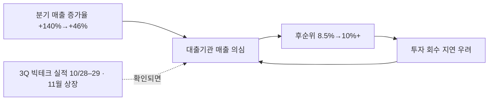

# Anthropic / AI 안전 심층 리서치 노트

**작성일**: 2026-06-28
**분석 범위**: Constitutional AI · Mythos 모델 · 펜타곤 분쟁 · 사업 현황 · 시장 충격
**검증 파일**: `verified-anthropic-ai-safety-2026-06-28.md`

---

## 1. Constitutional AI & 안전 연구 체계

### 1.1 CAI 방법론

Constitutional AI는 2022년 발표된 Anthropic 고유의 AI 정렬 방법론. 기존 RLHF의 인간 라벨러 의존을 줄이고, AI 자체가 명시적 원칙(Constitution)에 따라 자가 비판·수정하는 구조.

| 구분 | RLHF | Constitutional AI |
|------|------|-------------------|
| 피드백 주체 | 인간 라벨러 | AI 자체 + 명시적 원칙 |
| 비용 | 고비용 인력 | 합성 데이터로 확장 |
| 투명성 | 낮음 (암묵적 선호) | 높음 (원칙 공개) |

**2단계 작동**: ① SL-CAI — 모델이 자체 응답을 원칙에 따라 비판·수정, 수정본으로 파인튜닝 ② RLAIF — AI가 쌍별 선호 데이터 생성 → 인간 없이 보상 모델 훈련 → PPO 적용.

**최신 진화**:
- Claude 3 (2024.3): Character Training 도입
- Constitution 대폭 개정 (2026.1)
- Claude 4/4.5: CAI + RLHF + 추가 파인튜닝 하이브리드
- "Soul Document" (2025.12): 14,000 토큰 분량, Claude의 정체성·감정·안전 프로토콜 정의. Amanda Askell 공식 확인

### 1.2 ASL 안전 등급 체계

BSL(생물안전등급) 모델링한 자체 프레임워크. RSP v3.1 (2026년 기준).

| 등급 | 정의 | 현황 |
|------|------|------|
| ASL-1 | 재앙적 위험 없음 (예: 체스 AI) | 현재 해당 모델 없음 |
| ASL-2 | 위험 능력 초기 징후, 실질적 상향 없음 | 2025.5 이전 전 모델 |
| **ASL-3** | CBRN 무기 개발 실질 지원 가능 | **2025.5 Claude Opus 4와 동시 발동** |
| ASL-4 | 자율적 AI R&D, 국가급 CBRN 역량 | 미발동 (임계값 부분 비공개) |

ASL-3 배포 기준: CBRN 차단 4겹 방어 — ① 접근 제어 ② 실시간 프롬프트 분류기 ③ 완성 분류기 ④ 완성 개입. 초기 생물무기 위험에 특화 집중.

### 1.3 해석가능성(Interpretability) 연구

Transformer Circuits 팀이 기계적 해석가능성(Mechanistic Interpretability) 선도.

| 시점 | 연구 | 핵심 성과 |
|------|------|-----------|
| 2024.5 | Scaling Monosemanticity | Claude 3 Sonnet에서 **3,400만 개** SAE 특징 추출 |
| 2025 | Circuit Tracing | Attribution Graph로 환각·탈옥 메커니즘 가시화. 오픈소스 공개 |
| 2025말 | 모델 복지 연구 | Concept Injection으로 내성적 자기인식 실험. Claude Opus 4.6 의식 확률 **15~20%** 자가 평가 |

경쟁사 대비: Anthropic(SAE+Circuit Tracing, 가장 체계적) > DeepMind(Gemma Scope 2, 실용적) > OpenAI(Superalignment 팀 해산 후 약화)

### 1.4 RSP 진화

| 버전 | 시기 | 변화 |
|------|------|------|
| v1.0 | 2023.9 | ASL 프레임워크 도입 |
| v2.0 | 2024.10 | 위험 평가 유연화 |
| v3.0 | 2026.2 | Frontier Safety Roadmaps·Risk Reports 의무화 |
| v3.1 | 2026 | 최신 |

### 1.5 조직 구조

- **창업**: Dario + Daniela Amodei + 11명 OpenAI 연구원 (2021년)
- **인력**: ~300명(2024초) → 950명(2024말) → **1,097명**(2025) — 471% 성장
- **핵심 영입**: Jan Leike (OpenAI Superalignment 팀장, 2024.5) → Alignment Science 신팀 총괄
- **주요 팀**: Interpretability · Alignment Science (Leike) · Safeguards Research (Sharma) · Model Welfare (Fish, 2025.4 신설)
- **Fellows Program**: 코호트 10~15명, 주간 $3,850, 월 컴퓨트 ~$15,000

---

## 2. Mythos 모델 & 사이버보안

### 2.1 핵심 역량

| 지표 | 수치 |
|------|------|
| 제로데이 익스플로잇 성공률 | **83%+** (1회 시도 기준) |
| 발견된 고/치명적 취약점 | **10,000개+** (2026.5 기준) |
| 1개월 내 인간 검증 통과 | 1,726개 (6,202 후보 중) |
| 고/치명적 심각도 | 1,094개 |
| 분석 오픈소스 프로젝트 | 1,000개+ (초기 1개월) |

**주요 발견**: FreeBSD 17년 NFS RCE, OpenBSD 27년 DoS, FFmpeg 16년 취약점, 웹 브라우저 4-취약점 체인 익스플로잇 (JIT 힙 스프레이로 렌더러+OS 샌드박스 탈출)

**UK AISI 독립 평가**: TLO 32단계 기업 네트워크 공격 시뮬레이션 최초 end-to-end 완료 — 정찰 → AD 자격증명 탈취 → CI/CD 피벗 → DB 유출

### 2.2 Project Glasswing

| 항목 | 내용 |
|------|------|
| 출범 | 2026.04.07 (50개 기관, 12개 창립 파트너) |
| 확장 | 2026.06.02 → +150개 기관, 15개국+ |
| 투자 | 모델 크레딧 $1억 + 오픈소스 보안 $400만 |
| 창립 파트너 | AWS, Apple, Broadcom, Cisco, Google, MS, NVIDIA, CrowdStrike, Palo Alto, JPMorgan, Linux Foundation |

### 2.3 NSA 청문회 & 수출 통제

- **2026.06.11**: 상원 정보위 Mark Warner — "Mythos가 거의 모든 기밀 시스템을 몇 시간 만에 침투" (인가된 레드팀 평가)
- **2026.06.12**: 상무부 수출 통제 — Fable 5 + Mythos 5 외국 국적자 접근 전면 금지
- **트리거**: "Plenty the Liberator" Fable 5 잠금해제 공개(6/10) → Amazon 신고 → 지침 하달
- **현재**: Mythos 5는 100개+ 신뢰 파트너에 제한 재배포. Fable 5는 전면 금지 유지

### 2.4 사이버보안 시장 임팩트

**초기 충격**: Cloudflare -14%, Akamai -16%+, Okta -8%, PANW -5.2%
**반전**: Glasswing 파트너십 후 CrowdStrike +70%, Palo Alto +70% 랠리
**Wedbush 목표주가 상향**: PANW $225→$300, CRWD $550→$700
**논리 전환**: "AI 피해자" → "AI 집행 레이어" 재평가

**Bruce Schneier 평가**: 방어자 우위 가능하나 "Anthropic 발표는 PR 플레이" — Aisle이 저렴한 공개 모델로 유사 재현
**9개월 리스크 윈도우**: Mythos급 모델의 공개 시장 출현까지 2026Q4~2027Q1 예상

---

## 3. Pentagon 분쟁 & 군사 AI 윤리

### 3.1 분쟁 타임라인

| 날짜 | 사건 |
|------|------|
| 2025.07 | $200M DoD 계약 체결 (Claude 최초 기밀 네트워크 승인) |
| 2026.01 | Hegseth "any lawful use" 180일 표준화 메모 |
| 2026.02.24 | 2/27 17:01까지 수용 또는 계약 종료 최후통첩 |
| 2026.02.26 | Amodei 공개 거부 — 2개 레드라인 철회 불가 |
| 2026.02.27 | Trump 행정명령 "즉시 사용 중단" + supply chain risk 지정. 동일날 이란 공습 개시 |
| 2026.03.09 | Anthropic 연방소송 제기 (수정헌법 1조·5조 위반) |
| 2026.03.26 | **1심 가처분 인용** — "위헌적 제1조 보복" (판사 Rita F. Lin) |
| 2026.04.08 | **DC 항소법원 집행정지 기각** — 국가 이익 형평성 판단 |
| 2026.05.19 | 항소심 구두변론 — 판사단 분열 |
| 2026.06 | 최종 판결 대기 중 |

### 3.2 2개 레드라인

1. **대량 국내 감시 금지**: 미국 시민 대규모 감시에 Claude 활용 불허 (수정헌법 4조)
2. **자율무기 금지**: 인간 승인 없는 자율 표적 선택·교전 불허

**충돌 본질**: DoD "all lawful purposes" vs. Anthropic 윤리적 제약 — "AI 사용 경계를 누가 결정하는가"

비교: OpenAI·Google·xAI 모두 "any lawful use" 수용 후 계약 유지. OpenAI는 이후 "조급하고 기회주의적 거래" 자기비판.

### 3.3 Claude-Maven 군사 활용

- **Maven Smart System**: Palantir $1.3B 계약, Claude 내장. 표적 순위 결정 + 법적 정당화 문서 자동 생성
- **Operation Epic Fury** (2026.02.27~): 첫 24시간 1,000건+ 표적 → 누적 11,000건+ (4월 중순)
- **Minab 여학교 폭격**: 168명+ 사망 (100명+ 12세 미만). "구식 정보" 판단이나 AI 역할 조사 중
- **구조적 문제**: Hegseth가 민간인 피해 평가팀 10명→1명(90% 감축) 사전 조치

### 3.4 산업 선례 효과

- DoD AI 워크로드 2/3 이상 OpenAI·Google·MS로 이전
- supply chain risk 지정은 통상 외국 적대 기업(화웨이 등) 대상 — 미국 기업 적용 극히 이례적
- CRS 보고서: 자율무기 의회 입법 부재, AI 사용 규칙을 의회가 제정해야 한다는 민주적 통제 문제

---

## 4. 사업 현황 & 시장 충격

### 4.1 기업가치 트래킹

| 시점 | 기업가치 | 라운드 |
|------|---------|--------|
| 2023.5 | $18.4B | Series C |
| 2025 | $61.5B | Series F |
| 2026.2 | $380B | Series G ($30B 조달) |
| **2026.5** | **$965B** | **Series H ($65B 조달)** |

누적 조달 ~$115B+. 핵심 전략 투자자: Amazon 총 ~$33B, Google ~$3B(14% 지분).

### 4.2 매출 현황

| 시점 | 총 ARR | Claude Code ARR |
|------|--------|----------------|
| 2024 말 | ~$0.5B | $0 |
| 2025 중 | ~$3B | ~$0.3B |
| 2026.2 | $14B | $2.5B |
| **2026.5** | **$47B** | ~$6B |

Claude Code: $0 → $2.5B ARR in 9개월 — 상업용 소프트웨어 역사상 전례 없는 성장. GitHub 공개 커밋의 4% 작성.

### 4.3 SaaSpocalypse

**2026.02.05~06**: Claude Cowork 출시 → 48시간 내 SaaS 시가총액 **$285B 증발**

| 종목 | 1일 낙폭 |
|------|---------|
| Gartner | -21.0% |
| LegalZoom | -19.68% |
| Thomson Reuters | -15.83% (역대 최대) |
| ServiceNow | -13.2% |
| Salesforce | -11.5% |

누적 $2T+ 손실 (2026.4 기준). 인당 라이선스(per-seat) 채택률 21%→15%, 성과 기반 계약 15%→40%.

### 4.4 경쟁 포지셔닝

- 미국 기업 AI 지출에서 **OpenAI 처음 추월** (기업 Anthropic 비율 4%→25%, 1년)
- 신규 기업 고객 매치업 **승률 70%** (vs OpenAI)
- 안전 브랜딩이 금융·법률·의료 규제 산업에서 프리미엄 프라이싱 가능케 함
- Google DeepMind: 핵심 연구자 유출 지속 (Shazeer, Jumper 등)

### 4.5 Amodei "기술의 청소년기" 에세이

- 2026.1 발표, ~15,000단어
- 화이트칼라 50% 일자리 소멸 (1~5년)
- 생화학 무기: LLM이 성공 확률 2~3배 상향 가능
- AI 독재: 중국 CCP의 "AI 기반 전체주의" 명확 경로 지목
- AI를 '청소년기'로 비유 — 잠재력 방대하나 충동적·위험·미통제

---

## 기존 보고서 연결점

| 기존 보고서 | 연결 포인트 |
|-------------|-------------|
| `ai_sw_company_msft_pltr.html` | Claude-Maven 패널 → Pentagon 분쟁 심화, Palantir $1.3B Maven 계약 |
| `ns_ai_defense_nexus.html` | Mythos·Pentagon·SaaS 패널 → Glasswing 200개 기관, 수출 통제 추가 |
| `ai_power_infra_investment_map.html` | Amazon $100B 컴퓨팅 인프라 계약 → DC 전력 수요 연결 |
| `robot/robot_overview.html` | Physical AI 맥락 — Anthropic의 에이전트 역량 확장 |

---

## 핵심 출처 (선별)

1. [Anthropic RSP v3.0](https://www.anthropic.com/news/responsible-scaling-policy-v3)
2. [ASL-3 발동](https://www.anthropic.com/news/activating-asl3-protections)
3. [Scaling Monosemanticity](https://transformer-circuits.pub/2024/scaling-monosemanticity/)
4. [Circuit Tracing 오픈소스](https://www.anthropic.com/research/open-source-circuit-tracing)
5. [Anthropic 사이버보안 평가](https://red.anthropic.com/2026/mythos-preview/)
6. [Project Glasswing 확장](https://www.anthropic.com/news/expanding-project-glasswing)
7. [NSA 청문회 — Security Affairs](https://securityaffairs.com/194016/ai/anthropics-mythos-ai-broke-into-almost-all-nsa-classified-systems-in-hours.html)
8. [수출 통제 — Fortune](https://fortune.com/2026/06/13/anthropic-disables-fable-mythos-export-controls-national-security-threat/)
9. [Pentagon 분쟁 타임라인 — TechPolicy](https://www.techpolicy.press/a-timeline-of-the-anthropic-pentagon-dispute/)
10. [CRS IN12669](https://www.congress.gov/crs-product/IN12669)
11. [Series H 발표](https://www.anthropic.com/news/series-h)
12. [SaaSpocalypse — xpert.digital](https://xpert.digital/en/saas-apocalypse-on-wall-street/)
13. [Claude Code $2.5B ARR — MindStudio](https://www.mindstudio.ai/blog/claude-code-2-5-billion-annualized-revenue-saas-comparison)
14. [기술의 청소년기 에세이](https://darioamodei.com/essay/the-adolescence-of-technology)
15. [Schneier on Mythos](https://www.schneier.com/blog/archives/2026/04/mythos-and-cybersecurity.html)

---

*본 리서치 노트는 2026-06-28 기준 공개 정보를 4개 병렬 에이전트로 수집·교차 검증하여 작성됨. 투자 의사결정의 단독 근거로 활용하지 마십시오.*

---

## 5. 2026-10-17 덧붙임 — 칩 금융 구조 · 연방 법안 초안 · 코드 리뷰 (Lead · 판단은 brain/routing)

> **근거**: routing r-20261017-15 · r-20261017-11 · r-20261017-10 (테제 상태 불변 · 장부 없음)

### 5.1 「프로젝트 노스스타」 600억 달러 칩 금융의 층 (② FT, 로이터·US뉴스 재인용 · FT 본문 미개봉)
| 층 | 금액 | 조건 | 담보·보증 |
|---|---|---|---|
| 선순위 | 약 420억 달러 | — | 브로드컴 보증 |
| 후순위 | 180억 달러 | 쿠폰 10%, 할인·수수료 포함 수익률 10% 초과 | 앤스로픽의 5년 구글 TPU 리스료 |
| └ 블랙스톤 펀드 | 90억 달러 (후순위의 절반) | 위와 같음 | 위와 같음 |

용량은 약 1.5GW TPU. 읽기: 고객(앤스로픽)의 신용위험이 공급사(브로드컴) 보증으로 넘어가는 크기가 처음 숫자로 나왔다 — ns_bigtech T2(그림자 차입) ⓐ, 장부 j-20261008-04(AVGO 부정)의 breaks_if 「조달 무산」 미발동. KBRA BB+(6월) 전언은 r-20261016-954.

### 5.2 연방 AI 안전 법안 초안 (② 폴리티코 · 채널 2곳)
- 개입 임계: 10억 달러 초과 피해 또는 50명 초과 사망·중상의 「임박한」 위험. 범위는 생물무기·통제 이탈·사이버 공격.
- 상무부 등록 제3자 기관의 정기 평가, 중대 위험 72시간 내 보고. 배포 중단은 상무부 요청 + 연방법원 명령으로만.
- 위험 공개·제3자 평가·사고 보고에서 일부 주 규제보다 연방법 우선. 개발사에 안전 프레임워크·투명성 보고서·내부고발자 보호 의무.
- 6월 공개한 Advanced AI Framework 기반. 캘리포니아 규제 지지 이력과 달리 「정부의 자의적 중단 방지」 조항을 넣었다.

### 5.3 코드 리뷰 재설계 (② 자사 블로그 요약 · 내부 지표)
클로드가 Claude Code 코드의 약 90% 작성 · 6~9월 병합 PR 2배+ · 되돌림률 −40%+ · 1회 리뷰 후 통과율 65%→78% · 평균 리뷰 2.08→1.32회 · 위험도별 사람 승인(저 0·중 1·고 2명). 외부 고객 지표가 아니다.

### 5.4 일정
IPO 마케팅 11/9~ 추정(② 삼성 이영진 표 (E)) — events.json에 anthropic T5 판정 창으로 올림.

## 6. 2026-10-18 덧붙임 — 신용 사다리 · 분기 매출 · GW당 산식 (Lead · 판단은 brain/routing)

> **근거**: routing r-20261018-10 · r-20261018-11 · r-20261018-12 (PR #141 · 테제 상태 불변 · 장부 없음). 숫자는 FT·로이터·딜룸 기사로 대조했고 FT 본문 전체는 열지 않았다.

### 6.1 칩 금융 금리 사다리 (② FT·로이터·딜룸)
| 시점 | 딜 | 층 | 금액 | 금리 | 비고 |
|---|---|---|---|---|---|
| 2026-06 | 아폴로 주도 약 350억(빅스카이) | 선순위(브로드컴 보증) | — | 5.75% | |
| 2026-06 | 同 | 후순위 | 약 44억 | 약 8.5% | KBRA BB+(투기 최상단·안정), FCF·EBITDA 미제공 → 위험 점수 방식 |
| 2026-10 | 노스스타 약 600억(약 1.5GW TPU) | 선순위(브로드컴 보증) | 약 420억 | — | |
| 2026-10 | 同 | 후순위(블랙스톤) | 90억 | 쿠폰 10%(수익률 10% 초과) | 미종결. 나머지 후순위 90억은 수개월 내 더 낮은 금리 가능 |
| 비교 | ICE BofA BB 공모 | — | — | 약 7% | |

읽기: 같은 회사의 후순위 금리가 4개월 새 8.5%→10%+로 올랐고, 보증이 붙은 선순위는 낮다. DS 양형모는 10%를 무위험 5%·등급 가산 2%p·「매출 의심」 3%p로 나눴다(③ 견해). ns_bigtech T4 ⓐ.

### 6.2 분기 매출 (② FT 보도, 노무라 미검증)
1Q26 48억 → 2Q26 115억(+140%) → 3Q26 168억 달러(+46%). 증가율은 산술. 성장은 계속되나 속도가 꺾였다는 읽기가 조달 금리 상승의 배경으로 거론된다.

### 6.3 GW당 산식 (③ 노무라, 가정)
2026말 5GW·ARR 1,200억 가정 → 1GW당 연 매출 200억 → 컴퓨트 60%면 연 120억 → 장비 5년 상각이면 GW당 건설 상한 약 600억 달러. ARR/GW가 오르면 DC 지출이 늘고 반대도 같다는 「바로미터」 논리. ns_bigtech T1 관측.

## 7. 2026-10-19 덧붙임 — 공익기금 · 캐나다 DC · 자체 고용 연구 (Lead · 판단은 brain/routing)

> **근거**: routing r-20261019-203 · r-20261019-107 · r-20261019-533 · r-20261019-508 (테제 상태 불변 · 장부 없음)

- **공익기금(① 회사 발표 10/18)**: 주주 승인 전제로 지분 5%를 앤스로픽 공익기금(전액 출자 LLC)에 출연. 기준점(미공개) 대비 기업가치가 50% 오를 때마다 이사회 재량으로 2%씩 추가. 로비·정치 기부 사용 금지. 공동창업자 80% 기부 서약·직원 지분 매칭 포함 약 20%가 공익 목적. 구조·마일스톤은 수개월 내 공개. 10/19 오전 ④ 헤드라인(r-107)을 ①로 올림.
- **캐나다 DC(② 삼성 브리핑)**: EverWind와 노바스코샤 포인트터퍼 데이터센터 임대 계약. EverWind 풍력 71억 달러 투자 계획. 계약 규모·MW 미공개.
- **자체 고용 연구(② 삼성 채널 요약 · 원문 미개봉)**: 8월 기준 AI 에이전트 작업시간이 인간의 6배, 대화형 세션 시간 약 80%가 인간 입력 대기, 엔지니어 1인당 커밋 6개월 새 5배, 기술조직 초급 비중 21%→14%, 신규 기술직 초급 채용 27%→9%, 직원 1인당 매출이 같은 단계 메타·구글의 2~4배.
- 재등장(새 숫자 아님): KBRA BB+ · 10년 컴퓨트 의무 5,180억 달러+ · 3Q 매출 168억 달러 — §6 및 r-20261018-11·r-20260929-09·r-20261015-102.
