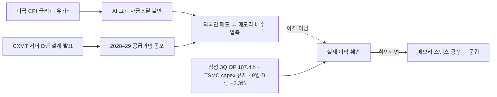

# 메모리 공급 위기 — Apple × CXMT × HBM Crowding-Out

> **작성일**: 2026.06.30
> **출처**: FT, Ming-Chi Kuo (TF International), Benzinga, Tom's Hardware, WCCFTech, Fortune, Seeking Alpha, TechTimes, Tom's Guide, SemiAnalysis 등

---

## 1. 개요 — AI가 만든 메모리 공급 위기

### 구조적 문제: HBM Crowding-Out

| 지표 | 수치 |
|---|---|
| HBM 수익성 vs 범용 DRAM | **3~4배** |
| HBM으로 전환된 웨이퍼 비중 | DRAM 전체의 **~25%** (2022년 이후 누적) |
| AI DC의 글로벌 DRAM 소비 비중 | **~70%** |
| 2027년 consumer→DC 추가 재배분 | **15~20%** 이동 예상 |
| DRAM 가격 상승 (2025~2027) | **275~300%** (2017~18 슈퍼사이클 90%의 3배+) |
| DDR5 32GB 모듈 가격 | $149 → **$239** (+60%, Samsung 기준) |
| DDR5 계약가 | ~$7 → **$19.50+** (+100%~178%) |

### 핵심 메커니즘

```
HBM 수익성 3~4배 > 범용 DRAM
   ↓
삼성·SK·Micron → HBM 생산 집중 (웨이퍼 25%+ 전환)
   ↓
범용 DDR5·LPDDR 공급 급감 → 가격 ~4배↑
   ↓
소비자 가전(Apple·PC) 공급 부족 → 감산·가격 인상
   ↓
대안 공급처(CXMT) 모색 + 반독점 소송
```

---

## 2. Apple × CXMT — 비용이 아니라 공급 생존

### Apple의 CXMT 로비 (FT, 2026.06.27)

| 항목 | 내용 |
|---|---|
| 시작 시점 | **2026년 5월 초** |
| 대상 | 미국 상무부 + 워싱턴 다채널 로비 |
| CXMT 제재 상태 | 국방부 **1260H 리스트** (중국 군 연관 기업) |
| CXMT 가격 경쟁력 | 삼성·SK·Micron 대비 **10~30% 저렴** |
| 목적 | ~~비용 절감~~ → **공급 리스크 관리** |

### 2022년 YMTC vs 2026년 CXMT — 질적 전환

| 구분 | YMTC (2022) | CXMT (2026) |
|---|---|---|
| 칩 종류 | NAND | DRAM |
| 목적 | **비용 절감** | **공급 리스크 관리** |
| 배경 | 가격 경쟁력 확보 | LPDDR 공급 부족 위기 |
| 제재 | Entity List | 1260H List |

### Apple 실질 영향

| 지표 | 수치 |
|---|---|
| A20칩 물량 영향 | H2 2026~Q1 2027 **10~20% 하향** |
| iPhone 18 예상 가격 인상 | **최대 $270** |
| iPhone 18 DRAM | 8GB → **9GB** (당초 기대 대비 보수적) |
| 미국 스마트폰·PC 가격 인상 | **~15%** (Morgan Stanley) |

### Ming-Chi Kuo 핵심 분석

> "The memory supply-demand gap will keep widening through 2027. That is the real reason Apple is lobbying the White House to keep CXMT off the Entity List."

- 압박이 **비용**에서 **공급 갭**으로 전환
- 2026년 consumer 배분 중 **15~20%가 2027년에 DC로 추가 이동** 예상
- CXMT에서 사더라도 비용·공급 문제를 **본질적으로 해결 못함** — IPO 자료상 중국 내수조차 충족 못하는 생산 능력
- 실질 효과: 삼성·SK·Micron 대비 **협상 레버리지 강화**가 가장 큰 목적

---

## 3. CXMT 현황

| 지표 | 수치 |
|---|---|
| 2026년 말 목표 웨이퍼 | **300~350K wafers/month** |
| 글로벌 순위 | #4 근접 (삼성·SK·Micron 다음) |
| H1 2026 매출 | **1,100~1,200억 위안** 예상 |
| DDR5 스펙 | DDR5-8000, LPDDR5X-10667 시연 |
| 서버 라인업 | RDIMM, MRDIMM, TFF MRDIMM |
| 제재 상태 | 국방부 1260H 리스트 (Entity List 아님) |

### CXMT의 한계

1. **절대 생산량 부족** — IPO 자료상 중국 내수조차 충족 못함
2. **제재 리스크** — EUV 장비 도입 불가, 기술 천장 존재
3. **Apple 도입 시에도** 글로벌 공급 갭 해소 안됨
4. **품질·안정성** — 서버/모바일급 검증 이력 제한적

### 그러나 시장에 주는 신호

- Apple급 빅테크가 CXMT 검토 → **CXMT가 "국내 대체" 수준에서 "글로벌 #4"로 인식 전환**
- 삼성·SK·Micron의 **범용 DRAM 가격결정력에 구조적 리스크** 시그널
- 실제 도입 여부보다 **협상 레버리지 도구**로서의 가치

---

## 4. 반독점 소송 — RAMpocalypse

### 소송 개요 (2026.06.25)

| 항목 | 내용 |
|---|---|
| 피고 | 삼성전자, SK하이닉스, Micron |
| 원고 | 17명 (개인·중소기업) |
| 법원 | 미국 연방법원 |
| 혐의 | **2022년부터 DRAM 공급·가격 담합** |
| 주장 핵심 | HBM 전환을 빌미로 DDR3/DDR4 생산 의도적 축소 |
| 가격 상승 주장 | **4년간 700%** |
| 시장 점유율 | 3사 합산 **~90%** (tight oligopoly) |

### 전과 이력

- **2005년**: 삼성 $300M, SK하이닉스 $185M 벌금 (미국 DOJ DRAM 담합)
- 현재 소송이 집단소송(class action)으로 확대될 경우 규모 상당

### 투자 시사점

- 소송 자체는 결과까지 수년 소요 → 즉시 실적 영향 제한적
- 그러나 **규제 리스크 프리미엄** + **HBM 집중 전략에 대한 정당성 공방**
- 3사가 범용 DRAM 생산을 늘리도록 압박하는 **간접적 효과** 가능

---

## 5. 한국 반도체 기업 영향

### 삼성전자

| 관점 | 분석 |
|---|---|
| **HBM** | HBM4 양산 본격화, 수익성 3~4배 유지 → 성장 드라이버 건재 |
| **범용 DRAM** | CXMT 저가 공세 + Apple 레버리지 → 마진 압박 가능 |
| **소송 리스크** | 2005년 전과, 집단소송 확대 시 벌금·합의금 변수 |
| **전략 딜레마** | HBM 집중 vs 범용 DRAM 공급 의무 — 양립 어려움 |

### SK하이닉스

| 관점 | 분석 |
|---|---|
| **HBM** | 글로벌 1위, 2026 캐파 "사실상 완판" |
| **범용 DRAM** | DDR5 수익성 우선 전략으로 HBM4 램프 속도 조절 중 |
| **CXMT 영향** | HBM은 CXMT 진입 불가 → 직접 위협 없음. 범용은 간접 압박 |
| **소송 리스크** | 삼성과 동일 |

### 핵심 테제

> **HBM 프리미엄은 유지되나, 범용 DRAM에서 CXMT의 부상은 삼성·SK의 가격결정력을 구조적으로 제약하는 변수. Apple의 CXMT 로비는 실제 도입 여부보다 협상 레버리지로서 의미가 크며, 반독점 소송은 3사의 HBM 집중 전략에 대한 규제 리스크를 환기시킨다.**

---

## 6. 투자 프레임워크

### Bullish

- HBM 슈퍼사이클은 **공급 부족이 가격을 떠받치는** 구조 → 삼성·SK·Micron 실적 호조 지속
- DRAM 가격 275~300% 상승은 역사적 최대급 사이클
- Apple조차 공급 확보에 사활 → **메모리 = 희소자원** 확인

### Bearish / Risk

- CXMT 300~350K wafers/month → **2027년 범용 DRAM 공급 과잉 반전** 가능성
- 반독점 소송 확대 시 **벌금·규제 강화**
- Apple 협상 레버리지 강화 → 삼성·SK **범용 DRAM 판가 양보 압력**
- HBM 집중이 장기적으로 **범용 DRAM 시장 점유율 잠식** 초래

### Kill Criteria

1. CXMT의 **서버급 DDR5 양산 검증** 완료 + 빅테크 대량 도입 확정
2. 반독점 소송에서 **유의미한 판결·합의** 도출
3. DRAM 계약가 **2분기 연속 하락** 전환
4. HBM 마진이 **범용 DRAM 대비 2배 이하**로 축소

---

## 7. Google × CXMT 루머 (별건)

Google-CXMT 도입 검토 루머도 있었으나 신뢰도 낮음:

| 항목 | 내용 |
|---|---|
| 출처 | Southern Value (X 계정) — "Sundar Pichai 관련 소스" |
| 용도 추정 | 차세대 TPU 탑재용 |
| **반박** | Ming-Chi Kuo: "Google has no concrete plan" |
| 원 소스 반론 | "evaluating ≠ concrete plan" |
| 판단 | **미확인 루머, 별도 트래킹 필요** |

---

*이 문서는 투자 판단을 위한 참고 자료이며, 특정 종목의 매수·매도를 권유하지 않습니다.*

---

## 8. 10/15 코스피 −7.57% 급락 — 이익 붕괴인가, 고점 논쟁인가 (2026-10-16 추가)

> **기준일**: 2026-10-16 · **근거**: routing r-20261016-926(judgment) · 장부 j-20261016-01·02 · 테제 `hbm-packaging/hbm_pkg_theme_memory_cycle.html#T2`(도전 ③ · 상태 불변)
> 등급: ① 공시·통계 / ② 미확인 / ③ 전문가·리포트 / ④ 수사. 확률은 Lead 판단이지 계산값이 아니다.

### 8.1 무슨 일이 있었나
- 10/15 코스피 **−7.57% (5,554)**, 서킷브레이커 발동. 10/16 약 +2% 일부 되돌림. (①)
- 외국인: **000660 16거래일 연속 순매도**, 10/16 **005930은 +1,819억 순매수 전환**. (① 수급 관측 · 테제 근거로 쓰지 않음, CLAUDE.md §J4)

### 8.2 원인 (겹친 네 갈래 + 메모리 고유 한 갈래)

| 원인 | 성격 | 등급 | 이익에 닿았나 |
|---|---|---|---|
| 미국 CPI 상회 → 금리 부담 | 매크로 할인율 | ① | 아니오 (배수) |
| 유가 상승 | 매크로 | ① | 아니오 (배수) |
| AI 데이터센터 고객 부채·자금조달 불안 | 수요 측 신용 | ③ | 아직 아니오 — 실제 주문 컷 없음 |
| CXMT 서버용 D램 신설계 발표 | 공급 측 경쟁 | ②③ | 아니오 — 설계 발표 단계, 서버 퀄·수율 미공개 |
| 2028–29 공급과잉 우려(머스크 언급 포함) | 사이클 시점 | ③④ | 아니오 — 2년 뒤 공급 |

### 8.3 반대편 — 이익은 아직 꺾이지 않았다

| 지표 | 값 | 등급 | 읽기 |
|---|---|---|---|
| 삼성전자 3Q26 잠정 영업이익 | **107.4조원** | ① | 이익 피크 진행 중 |
| TSMC 10/15 실적 · capex | **가이던스 유지(컷 없음)** | ① | 하이퍼스케일러 수요 유지 |
| 한국은행 9월 D램 수출가격(계약통화) | **+2.3%** | ① | 가격 턴 미확인 |
| 9월 확정 수출 D램 단가 | ~10/20 발표 대기(−19.5% 우려치) | 대기 | 첫 번째 확인점 |

### 8.4 해석
메모리는 주가 고점이 이익 고점보다 약 1년 앞서는 업종이다. 이익 고점을 2027로 본다면 2026 하반기에 「고점 논쟁」이 시작되는 것은 정상 경로이고, 이번 급락은 **이익 훼손이 아니라 배수(멀티플) 압축**이다. 따라서 V자보다 「실적은 좋고 주가는 박스권」 구간이 길어질 가능성을 기본으로 둔다.



### 8.5 시나리오 (1–3개월 · Lead 판단)

| 시나리오 | 확률 | 촉발 | 성격 |
|---|---|---|---|
| 박스권 후 회복 | **55%** | 10/29 삼성 콜에서 HBM4(엔비디아) 일정 확인 → 외국인 복귀 | 배수 회복 |
| 추가 하락 | **30%** | ~10/20 9월 확정 수출 약세 + CXMT 납품 보도 중첩 | 배수 추가 압축 (이익 아님) |
| 본격 다운사이클 | **15%** | AI 고객 자금줄 실제 차단 → 주문 감소 | 이익 훼손 |

### 8.6 이름별 판정 (장부 · 30/90일 · SMH 대비 초과수익 채점)

| 장부 | 이름 | 스탠스 | 기준가(10/16 종가) | 근거 |
|---|---|---|---|---|
| j-20261016-01 | 삼성전자 005930 | **긍정** | 217,000원 | HBM4 추격이 덜 반영, 10/16 외국인 순매수 |
| j-20261016-02 | SK하이닉스 000660 | **중립** | 1,265,000원 | HBM 프리미엄 기반영, 16일 매도, 공급 공포 노출 큼 |

### 8.7 breaks_if 와 조기 하향 조건
**확정 반증(하나라도 → 메모리 스탠스 중립):**
1. ~10/20 9월 확정 D램 수출단가 −19.5% 확인 (가격 턴 확정)
2. CXMT 서버 고객 퀄·수율 공개
3. 10/29 삼성 실적 콜에서 HBM4 일정이 흐려짐

**조기 하향(둘이 겹치면 확정 지표 전이라도 005930 긍정 → 중립):**
1. CXMT의 구체적 서버 D램 공급·고객 테스트 보도 (발표 이상) — *10/16 현재 가장 가까움*
2. D램 현물 또는 계약가 2주 연속 하락
3. 하이퍼스케일러 capex 컷 또는 AI 데이터센터 자금 실제 차단
4. 외국인 매도가 005930으로 다시 연장

판정일: `resolve_by` 2026-10-29 (삼성 실적 콜). 6장 Kill Criteria와 함께 읽는다.

### 8.8 야간 점검 — 10/16 22:00 KST (스탠스 불변)

> **근거**: routing r-20261016-993(judgment) · r-20261016-990(스마트폰) · intake `u-20261016-lead-nightly`(`intake/files/memory/2026-10-16/nightly_stance.md`) · 장부 행 없음(변경 없음)

**종가(①)**: 코스피 5,668.05(+2.05%) · 005930 215,500원(+2.62%) · 000660 1,272,000원(+0.79%). 미국은 10/15 종가가 마지막 완료 바(MU 931.24 +1.87% · NVDA 217.23 −1.84% · SOX 11,581.21).

| 조기 하향 조건 | 10/16 밤 상태 | 근거 | 등급 |
|---|---|---|---|
| (a) CXMT 서버 D램 공급·고객 테스트 구체 보도 | **켜짐(유지)** | 4F² 서버 DDR5 RDIMM 연내 출시 목표 — 퀄·수율·출하는 미공개 | ②③ |
| (b) D램 현물·계약가 2주 연속 하락 | 꺼짐 | 10/16 DDR5 16Gb 현물 $60.60(+0.28%), DDR4 보합. 9월 PC 고정가 +4.0% | ①② |
| (c) 하이퍼스케일러 capex 컷 / AI DC 자금 실제 차단 | 꺼짐 — **경계** | 2026 캡엑스 가이던스 $720–745B 컷 없음. 자금은 경색(CRWV 채권 80센트 아래·CDS ~1,000bp, DC 프로젝트채 하락, 오라클 CDS 288bp)이나 막힘 아님. 10/15 CRWV 채권·주가 반등 | ②③ |
| (d) 외국인 매도가 005930으로 재연장 | 꺼짐 | 10/16 외국인 005930 **+1,818억 순매수**(잠정), 000660 −791억 16일 연속 | ① 잠정 |

**breaks_if 갱신**
- 9월 D램 수출 단위가치(HSK 8542321010): **71,836달러/kg · 전월비 −18.9%** — 문턱 −19.5% 위라 문자 그대로는 미충족. 다만 수출액 +6.6%·중량 +31.4%라 단위가치 하락의 상당 부분이 구성(무게) 효과이고, 관세청 10/15 확정 보도자료에는 D램 단가가 따로 없다. 최근 3개월은 정정 가능 구간이라 ~10/20 정정치를 다시 본다. (②)
- CXMT 서버 퀄·수율: 미공개. 10/29 삼성 콜: 대기.

**반대편(조기 하향 네 조건 밖)**: IDC 3Q 스마트폰 출하 −22% YoY(분기 사상 최대 감소), 저가폰 BOM +70%가 거의 메모리 탓. PC −20.1%에 모바일이 붙었다. 서버·HBM이 상쇄하는 동안은 타이트가 유지되지만, 일부 업체 증산분이 2027 재고가 될 수 있다는 경로가 새로 생겼다(memory_cycle T7 ⓑ, r-20261016-990).

**시나리오(Lead 판단 · 불변)**: 박스권 후 회복 55% / 추가 하락 30% / 본격 다운사이클 15%. 10/16 반등은 박스권 경로 안이다. 확률을 움직이지 않은 이유: 네 조건 중 새로 켜진 것이 없고, 9월 단위가치가 문턱 위에서 멈췄다.

> 장부 메모: j-20261016-01·02의 `ref.price`(217,000 · 1,265,000)는 prices.json 기준 20:00 애프터마켓 값과 같고, 정규장 종가는 215,500 · 1,272,000이다. 장부 행은 고치지 않았다 — 사람이 확인할 칸.

### 8.9 야간 점검 — 10/17(토) 22:00 KST (스탠스 불변) · 10/16 미국장 메모리 투매

> **근거**: routing r-20261017-23(judgment) · r-20261017-06(10/16 미국장 투매) · r-20261017-07(제프리스 FCF) · r-20261017-15(앤스로픽 칩 금융) · intake `u-20261017-lead-nightly`(`intake/files/memory/2026-10-17/nightly_stance.md`) · 장부 행 없음(변경 없음)

**무슨 일이 있었나(①②)**: 한국장이 닫힌 뒤 10/16 미국장에서 메모리가 다시 밀렸다. SOX 11,581→11,137(−3.83%) · SMH 558.84→539.79(−3.41%) · MU 931.24→878.84(−5.63%)는 네이버 차트로 대조했다(①). 채널 집계로는 메모리 지수 −6.28%, SKHY ADR·샌디스크·WDC −6% 이상(②). 촉매로 거론된 것은 CXMT 1~9월 예비실적 재보도(r-20261016-996과 같은 숫자 — 서버 퀄·수율이 아니다)와 CRWV −11.91%(CDS 약 1,200bp, 로이터 10/16). ICE 반도체 지수는 8거래일 연속 하락(16년 최장), SOXX는 10월 고점 대비 −14%(②). 10/10 이후 메모리 6사 시총 7,000억 달러 이상 증발(investing.com 골드만 노트 보도 ②), WSJ 기준 주간 MU 약 −10%·SK하이닉스 약 −15%·삼성 −17%(②).

**반대편(③)**: 골드만(10/16)은 두 축을 나눴다 — 기술 돌파는 과대평가(고객 퀄·고수율 양산·HBM 격차에 시간), 캐파는 과소평가(CXMT 월 웨이퍼 2026말 29만→2028말 51.3만 장, +77%). 그래도 2028년 CXMT는 중국 D램 수요의 약 50%·HBM 40%만 채운다는 추정. 「삼성·하이닉스 PBR 1배 아래는 2028 다운사이클을 과하게 반영」이라는 하우스 의견은 장부에 넣지 않는다(③ 매수 의견). D램 현물은 DDR5가 오르는 중(10/16 +0.28%), DDR4 보합(①).

| 조기 하향 조건 | 10/17 상태 | 근거 | 등급 |
|---|---|---|---|
| (a) CXMT 서버 D램 공급·고객 퀄·테스트 구체 보도 | **켜짐(기존 바탕 · 신규 없음)** | SCMP 07/02 텐센트·바이트댄스 검증 전언·로이터 텐센트 약 30억 달러. 10/16 예비실적은 퀄·수율 아님 | ②③ |
| (b) D램 현물·계약가 2주 연속 하락 | 꺼짐 | DDR5 16Gb 현물 $60.60(+0.28%)·DDR4 보합(10/16). 9월 PC 고정가 +4.0% | ①② |
| (c) 하이퍼스케일러 capex 컷 / AI DC 자금 실제 차단 | 꺼짐 — **경계** | 컷 공시 없음. 4사 합산 FCF 4Q25 600억→2Q26 70억→3Q26 컨센 −130억 달러(제프리스 ③), CRWV CDS 약 1,200bp. 반대로 AWS CFO 「회수 3년 미만·잔고 약 5,000억」(②), 앤스로픽 600억 금융은 진행 중(선순위 약 420억 브로드컴 보증, FT ②) | ②③ |
| (d) 외국인 매도가 005930으로 재연장 | 꺼짐 | 10/16 외국인 005930 +1,746억(money-river)·+2,005억(k-stock)·+783,070주(subwayyy 확정). 5일 −4.4조. 000660 −791억, 16일 연속 | ① |

**breaks_if 갱신**: 9월 확정 D램 수출 단가 — 아직 없음(잠정 −18.9%, 문턱 −19.5%, 기한 ~10/20). CXMT 서버 퀄·수율 — 미공개. 10/29 삼성 콜 — 대기.

**시나리오(Lead 판단 · 불변)**: 박스권 후 회복 55% / 추가 하락 30% / 본격 다운사이클 15%. 10/16 미국장 투매는 「추가 하락 30%」 가지의 첫 마디일 수 있다 — 그 가지로 확률을 옮기려면 월요일(10/19) 한국장에서 외국인 매도가 005930으로 다시 번지는지((d))를 봐야 한다. (a)가 이미 켜져 있으므로 (d)가 켜지면 둘이 겹쳐 005930 긍정을 중립으로 내린다(사전 약속). 확률을 지금 움직이지 않은 이유: 새로 켜진 조건이 없고, 가격 하락 자체는 조건이 아니다.

> 종가 메모(정정 덧붙임): 8.8의 「정규장 종가 215,500 · 1,272,000」은 prices.json 스냅샷 값이었다. 네이버 차트 일봉(①, api.stock.naver.com/chart/domestic/item/{005930,000660}/day)과 money-river·alphapass는 10/16 종가를 **217,000 · 1,265,000**으로 적는다 — 장부 j-20261016-01·02의 `ref.price`가 맞고 8.8 메모가 틀렸다. 10/15 종가는 출처끼리 다르다(005930 네이버 차트 207,500 대 money-river 210,000 · 000660 1,238,000 대 alphapass 역산 1,262,000). 장부 기준일이 아니라 채점에는 안 쓰인다.

### 8.10 야간 점검 — 10/18(일) 22:00 KST (스탠스 불변) · 주말, 새 종가 없음

> **근거**: routing r-20261018-26(judgment) · r-20261018-09(BofA) · r-20261018-15(NVHBM) · r-20261018-10(DS·FT) · r-20261018-14(MS–Nscale) · intake `u-20261018-lead-nightly`(`intake/files/memory/2026-10-18/nightly_stance.md`) — 모두 PR #141 · 장부 행 없음(변경 없음)

**가격·수급**: 10/16(금) 이후 한국·미국 정규장 종가가 없다. 마지막 완료 바는 8.9의 10/16 값 그대로이고, 수급도 10/16이 마지막이다. 새 숫자를 만들지 않았다.

**주말 새 재료(양쪽)**

| 재료 | 방향 | 등급 | 내용 |
|---|---|---|---|
| BofA 글로벌 메모리 | 긍정 쪽 | ③ | 삼성·하이닉스 2027–28E P/E 2–3배(과거 업사이클 직전 4–7배)·P/B 약 1.0배(사이클 저점 수준). 2027–28 슈퍼사이클 ASP 지속, 2027 낮은 QoQ·2028 한 자릿수 EPS 감소는 인정 |
| DS 양형모 10/19 장전 | 긍정 쪽(밸류) · 경계(조달) | ③ | 삼성·하이닉스 10/2 이후 주가 −26%·선행 EPS +1% → PER 4.3→3.1배, 역산 요구수익률 32.9%. 급락은 AI 조달 금리 재평가와 레버리지 청산이라는 해석 |
| 서울경제 단독 NVHBM | 중립(구조 변화) | ② | 엔비디아가 NVHBM 3사에 베이스다이 TSMC 3나노·코어 1c 통일 요구, 삼성 수용 — 엔비디아 물량에서 턴키 차별점 소멸. 표준 HBM4/4E는 4나노 턴키 유지. UBS 2027 HBM 수요 615억Gb(+91%) 대 출하 546억Gb |
| FT 앤스로픽 노스스타 | 경계 | ② | 후순위 90억 쿠폰 10%+(4개월 전 8.5%, BB 공모 약 7%) — 조달 금리 상승, 무산 아님 |
| MS–Nscale 로턴 | 경계 | ② | 전력망 2030년대 전 불가로 단일 부지 계약 종료 — 캡엑스 가이던스 하향 아님 |
| 딥시크 V4.1 플래시(DS 인용, 자체 발표) | 부정 쪽(심리) | ④ | DeepSWE 77점 대 미국 73–74점·과제당 0.2달러 — 월요일 메모리 압력 후보. 9/10 딥시크 HBM 1/4 발표 때 SK하이닉스는 사흘 −9% 뒤 사흘 만에 회복(DS) |

| 조기 하향 조건 | 10/18 상태 | 근거 | 등급 |
|---|---|---|---|
| (a) CXMT 서버 D램 공급·고객 퀄·테스트 구체 보도 | **켜짐(기존 바탕 · 신규 없음)** | 10/17~18 새 서버 퀄·공급 보도 못 찾음. 4F² 서버 DDR5 RDIMM 연말 목표는 속도·용량·수율·퀄 미공개 | ②③ |
| (b) D램 현물·계약가 2주 연속 하락 | 꺼짐 | 마지막 세션 10/16 DDR5 16Gb $60.60(+0.28%)·DDR4 보합. 주말 세션 없음 | ① |
| (c) 하이퍼스케일러 capex 컷 / AI DC 자금 실제 차단 | 꺼짐 — **경계** | 앤스로픽 금리 8.5%→10%+, MS–Nscale 철회(전력망). 컷·무산 아님 | ② |
| (d) 외국인 매도가 005930으로 재연장 | 꺼짐(새 데이터 없음) | 마지막 10/16 외국인 005930 순매수. 10/19(월)이 첫 확인 창 | ① |

**시나리오(Lead 판단 · 불변)**: 박스권 후 회복 55% / 추가 하락 30% / 본격 다운사이클 15%. 움직이지 않은 이유: 주말이라 가격·수급이 없고 새로 켜진 조건이 없다. 새 재료는 밸류에이션 쪽(BofA·DS)과 조달 경계 쪽(FT·Nscale)이 엇갈린다. 월요일 확인 순서: (d) 10/19 외국인 005930 → ~10/20 9월 확정 D램 수출 단가 → 10/28–29 빅테크 실적·삼성 콜.

### 8.11 선행 지표 제안 — 조달 신용 → 외국인 수급 경로 (2026-10-19 추가 · 스탠스 불변)

> **근거**: routing r-20261017-401(문홍철 베이시스·FRED·7월 라인) · r-20261017-402(레짐) · r-20261018-401(마이크론 10-K) · r-20261018-402(CXMT 반대 증거) · r-20261017-403(윤지호) · intake `u-20261017-yt-3pro-moon` · `u-20261019-web-mu10k` · `u-20261019-web-ust10y-krx` · 장부 행 없음

**왜 넣나**: 8.2가 적은 급락 원인 중 「조달 금리 재평가·레버리지 청산」 갈래를 숫자 문턱으로 바꾼다. 문홍철(③)의 주장은 외국인의 한국 반도체 매도가 메모리 이익이 아니라 「미국채 숏 + AI 메모리 롱」 페어의 정리이고, 그 방아쇠가 코어위브 신용이라는 것이다. 맞다면 이익 지표((b) D램 가격)보다 신용 지표가 수급을 먼저 말한다. 아래 지표는 판단 재검토용이고 집행 신호가 아니다.

| # | 지표 | 문턱(제안) | 현재 | 출처·등급 | 무엇을 말하나 |
|---|---|---|---|---|---|
| 1 | 코어위브 회사채 금리 − (미국채 + 코어위브 5Y CDS) 괴리 | 정상 약 50bp / 경보 100bp 초과 | 약 200bp(출연자 자료, 9/22 균열) → **Lead 근사 10/15: −130~+50bp**(8.11a) | ③ C(출연자) · Lead 근사는 ② CNBC·로이터 입력 + ① FRED DGS5 | 신용 시장이 CDS로 설명 안 되는 추가 금리를 요구 = 강제 매도·유동성 프리미엄. 좁혀지면 페어 정리 압력 완화 |
| 2 | 미 10년물(DGS10) | 4.8%(숏 펌핑 시작 레벨, 9/8 첫 도달) · 위험 5.3%(10/5 고점 5.31) | 10/15 5.10 | ① FRED | 페어의 숏 다리. 4.8% 근처로 내려오면 숏커버 완료 신호 후보 |
| 3 | 한국 메모리 7월 저점 라인 | 005930 7월 종가 최저 207,000·장중 189,200 / 000660 1,322,000·1,246,000 | 10/16 종가 217,000(위) / 1,265,000(종가 기준 아래) — 8.9 정정 메모 기준(네이버 일봉). 10/15 005930 207,500으로 7월 종가 최저 207,000에 500원 위 · **10/19 종가 218,000(위, 장중 저 206,500) / 1,277,000(아래 유지)** — §8.11c | ② 공공데이터 종가 재게시 | 문홍철 「절대 깨지면 안 된다」. 삼성은 지키고 하이닉스는 이미 깼다 — Lead 분리(005930 긍정·000660 중립)와 같은 그림 |
| 4 | 외국인 005930 순매매 | 2거래일 연속 순매도면 조기 하향 (d) 후보 | 마지막 10/16 +90.6만 주 순매수. 직전 10/12~15 4일 연속 순매도 −1,623만 주(8.11b) · **10/19 +3,410억 순매수(잠정, 약 +156만 주) → (d) 카운트 0** — §8.11c | ② 네이버(KRX 재게시) | 1·2가 좁혀지는데 매도가 이어지면 이 경로는 틀렸다 |
| 5 | 마이크론 계약부채·RPO(다음 10-Q, 12월) | 감소·예치금 몰수 공시면 경보 | RPO 약 1,340억·계약부채 130억(9/3) | ① 10-K | 「하방 고정」(memory T1)의 장부 쪽 확인. 고객이 계약에서 빠지면 여기서 먼저 보인다 |
| 6 | 삼성·하이닉스 10월 말 콜의 LTA 비중 | 60~70%(이형수 ③) 확인 여부 | 미공개 | 회사 콜 | 확인되면 2028 급둔화 전제(윤지호 232→35.5→7.5 ④)가 약해진다 |
| 7 | CXMT 4F² 서버 DDR5 | 고객 퀄·수율·출하 물량 보도 | 「연내 샘플, 양산 잘해야 2분기」(이형수 ④) · 「위협 아님」(아이브스 ④) · 골드만 「설계 단계, 2026년 말 샘플 목표」(② r-20261019-103) | ②~④ | 조기 하향 (a)의 직접 판정. 의견은 반대 증거일 뿐 (a)를 끄지 않는다 |

**Lead 추론(가설 · 검증 전)**:
- 1과 2가 같이 좁혀지면(괴리 100bp 아래 + 10년물 4.9% 아래) 수급 압력은 2–4주 안에 줄어들 것으로 본다 → 시나리오 「박스권 후 회복 55%」 쪽 근거. 이번 주 확인할 것: 10/19 외국인 005930, 10/28 FOMC 전후 10년물.
- 1이 200bp 근처에 머물고 3에서 005930이 7월 종가 최저 207,000을 종가로 깨면, 이익과 무관한 수급 경로가 삼성까지 번진 것 → 조기 하향 (d)와 같은 방향. 그 경우 (a) 기존 바탕과 합쳐 「둘이 겹침」이 될 수 있다.
- 하이닉스가 이미 7월 종가 라인 아래라는 사실은 000660 중립을 바꾸지 않는다 — 원인이 실적이 아니라는 하이닉스 T1과 맞고, 반등 조건은 1·2다.
- 반대편: 문턱 50bp·4.8%는 출연자가 고른 숫자이고, 괴리는 레포가 직접 잰 적이 없다. 데이터원(TRACE 체결·CDS 호가)을 붙이기 전까지 1번은 ③으로만 쓴다.

**조기 하향 조건 상태(10/19 07:57 패킷 기준)**: (a) 기존 바탕 유지 — 새 서버 퀄·공급 보도 없음, 이형수·아이브스는 반대 증거(④) · (b) 꺼짐(새 세션 전) · (c) 꺼짐 — 조달 비용 상승이지 차단 아님 · (d) 꺼짐(10/19가 첫 확인 창). **스탠스 불변**: 005930 긍정 · 000660 중립 · 55/30/15.

#### 8.11a 지표 1·7 첫 측정 — X A-tier 10/19 (스탠스 불변)

> **근거**: routing r-20261019-100(CDS·2031채·베이시스) · r-101(프로젝트채) · r-102(JPM·이자) · r-103(골드만 CXMT) · r-104(CXMT ① 공시) · r-110(국민연금) · intake `u-20261019-x100`~`x113` · 장부 행 없음

**지표 1 — 코어위브 베이시스 근사(10/15)**: 채권수익률 − (DGS5 + 5Y CDS).

| 입력 | 값 | 등급 |
|---|---|---|
| 9.75% 2031년채 만기수익률 | 15.78%(CNBC) · 장중 약 16% → 약 14%(로이터) | ② |
| 5Y CDS | 장중 1,140bp 초과 · 마지막 약 1,038bp(CNBC) / 1,088bp(전달) | ② |
| DGS5 | 4.91% | ① |
| **근사 베이시스** | 15.78% 기준 **+49bp / −1bp / −53bp**(CDS 1,038 / 1,088 / 1,140) · 14% 기준 **약 −129bp** | 계산 |

- 읽기: 괴리는 「채권만 CDS보다 200bp 더 싸다」(문홍철 ③)가 아니라 **0 근처~음수**다. 보호 수요가 CDS로 몰린 그림이고, 채권 쪽 강제 매도 프리미엄은 이 근사에서 안 보인다. 제안 문턱(정상 50bp·경보 100bp 초과)으로 보면 **경보 아님**.
- 한계: 2031 만기 대 5Y CDS 만기 불일치, CDS 러닝/업프런트 호가 방식, 채권 체결 시각과 CDS 마지막 호가 시각 차이. TRACE 체결과 같은 시각 CDS 호가가 붙기 전까지 이 근사도 ②로만 쓴다.
- 같은 주 프로젝트채(③): 메타·블루아울 약 92 · 허트8 92~94 · QTS 88 미만 · 오라클 미시간 87 · CRWV 80 미만. 임차인 신용 순서대로 갈렸다 — 신용 경보가 네오클라우드에서 하이퍼스케일러 임차 채권으로 번졌으나 발행 차단은 아니다.
- JPM(③)이 다음 시험으로 적은 숫자: CRWV 다음 GPU 대출이 SOFR+5.50% 안쪽에서 닫히는가. 지표 1의 보조선으로 둔다.

**지표 7 — 골드만 CXMT 노트(10/16, ②)로 (a) 판정**: 4F²는 「아직 설계 단계, 2026년 말 샘플 목표」, 고객 인증·고수율 양산이 더 큰 과제. 2028년 말 월 캐파 CXMT 51.3만 대 삼성 93만·하이닉스 77만, 2028년에도 중국 D램 수요 약 50%·HBM 약 40%. **서버 공급·고객 퀄 사실이 아니다 → (a)는 기존 바탕 그대로, 새 점등 없음.** CXMT 1~9월 예비실적은 ① 공시로 올라왔고(r-104), 3분기 순이익 QoQ +1.0~3.9%로 매출(+15~20%)보다 크게 둔화 — 퀄 데이터는 아니다.

**지표 4 보조 — 국민연금**: 메르 계산(③) 국내주식 20.8% 선 = 코스피 5,380. 대신 추정(②) 9/18 24.4%, 밴드 ±8%p로 최대 약 80조 매수 여력. 연기금 7/1~9/28 삼성전자 −7,741억·SK하이닉스 +1조 5,021억(②). 5,380은 목표 교차점이지 매수 금지선이 아니다(Lead 해석).

**조기 하향 조건 상태(10/19 X 패킷 기준)**: (a) 기존 바탕 유지 — 골드만도 설계 단계로 명시, 새 점등 없음 · (b) 꺼짐 · (c) 꺼짐 — CDS 약 1,000bp·프로젝트채 하락은 조달 비용 상승이지 차단이 아니고, 하이퍼스케일러 캡엑스 컷 없음(판정 10/22 KST 메타 콜) · (d) 꺼짐. **스탠스 불변**: 005930 긍정 · 000660 중립 · 55/30/15.

#### 8.11b 지표 4·7 보강 — 텔레그램 주말 패킷 10/19 (스탠스 불변)

> **근거**: routing r-20261019-200(NVHBM) · r-201(외국인 수급) · r-208(BofA·DS → T1) · intake `u-20261019-web-naver_foreign_flows_1012_1016` · `u-20261019-web-nvhbm_sedaily_reuters` · 장부 행 없음 · 위 표 #3 종가는 8.9 정정 메모에 맞춰 고쳤다(215,500·1,272,000 → 217,000·1,265,000)

**지표 4 — 외국인 종목별(② 네이버, 수량×종가 근사)**:

| | 10/12 | 10/13 | 10/14 | 10/15 | 10/16 | 주간 |
|---|---|---|---|---|---|---|
| 005930 순매매(만 주) | −217.8 | −594.3 | −83.0 | −728.0 | **+90.6** | −1,532.5(약 −3.45조) |
| 000660 순매매(만 주) | −61.8 | −161.4 | −48.8 | −93.0 | −6.5 | −371.4(약 −5.27조) |

- 메리츠(③) 주간 코스피 외국인 11.2조 순매도 중 두 종목이 약 78%. 코스피 10/8 → 10/16 −14.45%(①).
- 읽기: 지난주 005930도 4일 연속 순매도로 컸다. 레포는 10/16 순매수를 (d) 리셋으로 읽어 왔고 이 줄도 그 규칙을 따른다 — **(d) 꺼짐, 첫 확인 창은 10/19·10/20 종가**.
- **해석 확정(Lead, 10/19 09:54 KST)**: (d)는 앞을 보는 트리거다. 10/16에 설정할 때 10/1~15 005930 외국인 순매도는 이미 알려져 있었고, 그날 스탠스 결정(긍정 유지·확신도 하향)에 반영됐다. 그래서 **10/12~15 순매도는 (d)에 세지 않는다**. 규칙: 10/16 순매수 리셋 이후 **정규장 기준 2거래일 연속 005930 외국인 순매도 = (d) 켜짐**. 첫 확인 창은 10/19·10/20 종가다. 장중 값은 판정에 쓰지 않는다.

**지표 7 옆 — 삼성 NVHBM 베이스다이(② 서울경제 단독·로이터 인용)**: 엔비디아가 NVHBM(HBM4E) 공급 3사에 베이스다이 TSMC 3nm·코어 1c 통일을 요구했고 삼성이 수용. (+) 공급사 셋 중 하나로 남음 · (−) 엔비디아 물량에서 턴키·파운드리 몫 소멸. **10/29 breaks_if(「HBM4 일정이 흐려짐」)는 2026 HBM4 8Hi 이야기라 이 보도로 켜지지도 꺼지지도 않는다.** 10/29 콜에서 같이 볼 것: NVHBM 샘플·퀄 일정 언급, 베이스다이 자체 생산 여부.

**T1 쪽(③ BofA·DS)**: 2028 한 자릿수 EPS 감소 인정·절대 수준 고점 부근(BofA), 역산 장기 ROE 12% = 초과이익 0 가격(DS). 하방 완만 경로.

**조기 하향 조건 상태(10/19 텔레그램 패킷 기준)**: (a) 기존 바탕 유지 · (b) 꺼짐 · (c) 꺼짐 — MS–Nscale은 같은 부지 재보도(전력망), 앤스로픽 공익기금은 희석 조항이지 조달 차단 아님 · (d) 꺼짐(규칙상, 10/19~20 종가 대기). **스탠스 불변**: 005930 긍정 · 000660 중립 · 55/30/15.

#### 8.11c 지표 3·4 — 10/19 정규장 마감 (스탠스 불변)

> **근거**: routing r-20261019-253 · intake `u-20261019-web-krx_close_foreign_1019` · 장부 행 없음

| | 10/16 종가 | 10/19 종가 | 10/19 장중 저 | 7월 종가 최저 라인 | 외국인 10/19 |
|---|---|---|---|---|---|
| 005930 | 217,000 | **218,000**(+0.46%) | 206,500 | 207,000 → **종가 위** | **+3,410억 순매수**(잠정 · 근사 +156만 주 · 2일 연속) |
| 000660 | 1,265,000 | **1,277,000**(+0.95%) | 1,208,000 | 1,322,000 → 아래 유지 | −434억(17일 연속 순매도, 잠정) |

- 출처: 종가는 네이버 fchart 일봉(KRX 정규장, ②). 외국인은 알파패스 마감 집계(「KRX 투자자별 집계」 표기, ② 잠정). 네이버 종목별 확정 수량은 15:55 KST 현재 10/16까지만 게시 — 확정치로 다시 대조한다. 서울경제 봇 15:35 시장 합계(외국인 −379억)는 마감 직후 스냅샷으로 알파패스(+6,248억)와 어긋나 종목 판정에 쓰지 않는다.
- 주의: 네이버 모바일 basic의 15:40 이후 가격은 NXT 애프터마켓 통합가라 전일비가 NXT 종가(215,500·1,272,000) 기준이다 — 지표 3은 정규장 일봉으로만 잰다.
- **지표 3**: 005930은 장중 206,500으로 7월 종가 최저 207,000을 장중에 깼다가 종가 218,000으로 회복 — 라인은 종가 기준이라 **지킴**. 000660은 종가 기준 아래 그대로.
- **지표 4 / (d)**: 10/19 외국인 005930 **순매수** → 10/16 리셋 이후 연속 순매도 **0일**. (d) 1일차 아님. 다음 판정 창은 10/20·10/21 종가(2일 연속 순매도여야 점등).
- 읽기: 코스피 −3.17% 개장 뒤 +1.76% 마감. 외국인이 삼성은 사고 하이닉스는 17일째 팔았다 — 005930 긍정·000660 중립 분리와 같은 그림이 하루 더 이어졌다.

**조기 하향 조건 상태(10/19 15:30 정규장 마감 기준)**: (a) 기존 바탕 유지 — CXMT 매출 8배(WSJ)는 r-104 중복, 퀄 아님 · (b) 꺼짐 · (c) 꺼짐 · (d) 꺼짐 — 10/19 순매수(잠정), 카운트 0. **스탠스 불변**: 005930 긍정 · 000660 중립 · 55/30/15.
