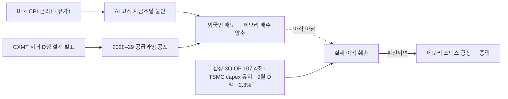

# 메모리 공급 위기 — Apple × CXMT × HBM Crowding-Out

> **작성일**: 2026.06.30
> **출처**: FT, Ming-Chi Kuo (TF International), Benzinga, Tom's Hardware, WCCFTech, Fortune, Seeking Alpha, TechTimes, Tom's Guide, SemiAnalysis 등

---

## 1. 개요 — AI가 만든 메모리 공급 위기

### 구조적 문제: HBM Crowding-Out

| 지표 | 수치 |
|---|---|
| HBM 수익성 vs 범용 DRAM | **3~4배** |
| HBM으로 전환된 웨이퍼 비중 | DRAM 전체의 **~25%** (2022년 이후 누적) |
| AI DC의 글로벌 DRAM 소비 비중 | **~70%** |
| 2027년 consumer→DC 추가 재배분 | **15~20%** 이동 예상 |
| DRAM 가격 상승 (2025~2027) | **275~300%** (2017~18 슈퍼사이클 90%의 3배+) |
| DDR5 32GB 모듈 가격 | $149 → **$239** (+60%, Samsung 기준) |
| DDR5 계약가 | ~$7 → **$19.50+** (+100%~178%) |

### 핵심 메커니즘

```
HBM 수익성 3~4배 > 범용 DRAM
   ↓
삼성·SK·Micron → HBM 생산 집중 (웨이퍼 25%+ 전환)
   ↓
범용 DDR5·LPDDR 공급 급감 → 가격 ~4배↑
   ↓
소비자 가전(Apple·PC) 공급 부족 → 감산·가격 인상
   ↓
대안 공급처(CXMT) 모색 + 반독점 소송
```

---

## 2. Apple × CXMT — 비용이 아니라 공급 생존

### Apple의 CXMT 로비 (FT, 2026.06.27)

| 항목 | 내용 |
|---|---|
| 시작 시점 | **2026년 5월 초** |
| 대상 | 미국 상무부 + 워싱턴 다채널 로비 |
| CXMT 제재 상태 | 국방부 **1260H 리스트** (중국 군 연관 기업) |
| CXMT 가격 경쟁력 | 삼성·SK·Micron 대비 **10~30% 저렴** |
| 목적 | ~~비용 절감~~ → **공급 리스크 관리** |

### 2022년 YMTC vs 2026년 CXMT — 질적 전환

| 구분 | YMTC (2022) | CXMT (2026) |
|---|---|---|
| 칩 종류 | NAND | DRAM |
| 목적 | **비용 절감** | **공급 리스크 관리** |
| 배경 | 가격 경쟁력 확보 | LPDDR 공급 부족 위기 |
| 제재 | Entity List | 1260H List |

### Apple 실질 영향

| 지표 | 수치 |
|---|---|
| A20칩 물량 영향 | H2 2026~Q1 2027 **10~20% 하향** |
| iPhone 18 예상 가격 인상 | **최대 $270** |
| iPhone 18 DRAM | 8GB → **9GB** (당초 기대 대비 보수적) |
| 미국 스마트폰·PC 가격 인상 | **~15%** (Morgan Stanley) |

### Ming-Chi Kuo 핵심 분석

> "The memory supply-demand gap will keep widening through 2027. That is the real reason Apple is lobbying the White House to keep CXMT off the Entity List."

- 압박이 **비용**에서 **공급 갭**으로 전환
- 2026년 consumer 배분 중 **15~20%가 2027년에 DC로 추가 이동** 예상
- CXMT에서 사더라도 비용·공급 문제를 **본질적으로 해결 못함** — IPO 자료상 중국 내수조차 충족 못하는 생산 능력
- 실질 효과: 삼성·SK·Micron 대비 **협상 레버리지 강화**가 가장 큰 목적

---

## 3. CXMT 현황

| 지표 | 수치 |
|---|---|
| 2026년 말 목표 웨이퍼 | **300~350K wafers/month** |
| 글로벌 순위 | #4 근접 (삼성·SK·Micron 다음) |
| H1 2026 매출 | **1,100~1,200억 위안** 예상 |
| DDR5 스펙 | DDR5-8000, LPDDR5X-10667 시연 |
| 서버 라인업 | RDIMM, MRDIMM, TFF MRDIMM |
| 제재 상태 | 국방부 1260H 리스트 (Entity List 아님) |

### CXMT의 한계

1. **절대 생산량 부족** — IPO 자료상 중국 내수조차 충족 못함
2. **제재 리스크** — EUV 장비 도입 불가, 기술 천장 존재
3. **Apple 도입 시에도** 글로벌 공급 갭 해소 안됨
4. **품질·안정성** — 서버/모바일급 검증 이력 제한적

### 그러나 시장에 주는 신호

- Apple급 빅테크가 CXMT 검토 → **CXMT가 "국내 대체" 수준에서 "글로벌 #4"로 인식 전환**
- 삼성·SK·Micron의 **범용 DRAM 가격결정력에 구조적 리스크** 시그널
- 실제 도입 여부보다 **협상 레버리지 도구**로서의 가치

---

## 4. 반독점 소송 — RAMpocalypse

### 소송 개요 (2026.06.25)

| 항목 | 내용 |
|---|---|
| 피고 | 삼성전자, SK하이닉스, Micron |
| 원고 | 17명 (개인·중소기업) |
| 법원 | 미국 연방법원 |
| 혐의 | **2022년부터 DRAM 공급·가격 담합** |
| 주장 핵심 | HBM 전환을 빌미로 DDR3/DDR4 생산 의도적 축소 |
| 가격 상승 주장 | **4년간 700%** |
| 시장 점유율 | 3사 합산 **~90%** (tight oligopoly) |

### 전과 이력

- **2005년**: 삼성 $300M, SK하이닉스 $185M 벌금 (미국 DOJ DRAM 담합)
- 현재 소송이 집단소송(class action)으로 확대될 경우 규모 상당

### 투자 시사점

- 소송 자체는 결과까지 수년 소요 → 즉시 실적 영향 제한적
- 그러나 **규제 리스크 프리미엄** + **HBM 집중 전략에 대한 정당성 공방**
- 3사가 범용 DRAM 생산을 늘리도록 압박하는 **간접적 효과** 가능

---

## 5. 한국 반도체 기업 영향

### 삼성전자

| 관점 | 분석 |
|---|---|
| **HBM** | HBM4 양산 본격화, 수익성 3~4배 유지 → 성장 드라이버 건재 |
| **범용 DRAM** | CXMT 저가 공세 + Apple 레버리지 → 마진 압박 가능 |
| **소송 리스크** | 2005년 전과, 집단소송 확대 시 벌금·합의금 변수 |
| **전략 딜레마** | HBM 집중 vs 범용 DRAM 공급 의무 — 양립 어려움 |

### SK하이닉스

| 관점 | 분석 |
|---|---|
| **HBM** | 글로벌 1위, 2026 캐파 "사실상 완판" |
| **범용 DRAM** | DDR5 수익성 우선 전략으로 HBM4 램프 속도 조절 중 |
| **CXMT 영향** | HBM은 CXMT 진입 불가 → 직접 위협 없음. 범용은 간접 압박 |
| **소송 리스크** | 삼성과 동일 |

### 핵심 테제

> **HBM 프리미엄은 유지되나, 범용 DRAM에서 CXMT의 부상은 삼성·SK의 가격결정력을 구조적으로 제약하는 변수. Apple의 CXMT 로비는 실제 도입 여부보다 협상 레버리지로서 의미가 크며, 반독점 소송은 3사의 HBM 집중 전략에 대한 규제 리스크를 환기시킨다.**

---

## 6. 투자 프레임워크

### Bullish

- HBM 슈퍼사이클은 **공급 부족이 가격을 떠받치는** 구조 → 삼성·SK·Micron 실적 호조 지속
- DRAM 가격 275~300% 상승은 역사적 최대급 사이클
- Apple조차 공급 확보에 사활 → **메모리 = 희소자원** 확인

### Bearish / Risk

- CXMT 300~350K wafers/month → **2027년 범용 DRAM 공급 과잉 반전** 가능성
- 반독점 소송 확대 시 **벌금·규제 강화**
- Apple 협상 레버리지 강화 → 삼성·SK **범용 DRAM 판가 양보 압력**
- HBM 집중이 장기적으로 **범용 DRAM 시장 점유율 잠식** 초래

### Kill Criteria

1. CXMT의 **서버급 DDR5 양산 검증** 완료 + 빅테크 대량 도입 확정
2. 반독점 소송에서 **유의미한 판결·합의** 도출
3. DRAM 계약가 **2분기 연속 하락** 전환
4. HBM 마진이 **범용 DRAM 대비 2배 이하**로 축소

---

## 7. Google × CXMT 루머 (별건)

Google-CXMT 도입 검토 루머도 있었으나 신뢰도 낮음:

| 항목 | 내용 |
|---|---|
| 출처 | Southern Value (X 계정) — "Sundar Pichai 관련 소스" |
| 용도 추정 | 차세대 TPU 탑재용 |
| **반박** | Ming-Chi Kuo: "Google has no concrete plan" |
| 원 소스 반론 | "evaluating ≠ concrete plan" |
| 판단 | **미확인 루머, 별도 트래킹 필요** |

---

*이 문서는 투자 판단을 위한 참고 자료이며, 특정 종목의 매수·매도를 권유하지 않습니다.*

---

## 8. 10/15 코스피 −7.57% 급락 — 이익 붕괴인가, 고점 논쟁인가 (2026-10-16 추가)

> **기준일**: 2026-10-16 · **근거**: routing r-20261016-926(judgment) · 장부 j-20261016-01·02 · 테제 `hbm-packaging/hbm_pkg_theme_memory_cycle.html#T2`(도전 ③ · 상태 불변)
> 등급: ① 공시·통계 / ② 미확인 / ③ 전문가·리포트 / ④ 수사. 확률은 Lead 판단이지 계산값이 아니다.

### 8.1 무슨 일이 있었나
- 10/15 코스피 **−7.57% (5,554)**, 서킷브레이커 발동. 10/16 약 +2% 일부 되돌림. (①)
- 외국인: **000660 16거래일 연속 순매도**, 10/16 **005930은 +1,819억 순매수 전환**. (① 수급 관측 · 테제 근거로 쓰지 않음, CLAUDE.md §J4)

### 8.2 원인 (겹친 네 갈래 + 메모리 고유 한 갈래)

| 원인 | 성격 | 등급 | 이익에 닿았나 |
|---|---|---|---|
| 미국 CPI 상회 → 금리 부담 | 매크로 할인율 | ① | 아니오 (배수) |
| 유가 상승 | 매크로 | ① | 아니오 (배수) |
| AI 데이터센터 고객 부채·자금조달 불안 | 수요 측 신용 | ③ | 아직 아니오 — 실제 주문 컷 없음 |
| CXMT 서버용 D램 신설계 발표 | 공급 측 경쟁 | ②③ | 아니오 — 설계 발표 단계, 서버 퀄·수율 미공개 |
| 2028–29 공급과잉 우려(머스크 언급 포함) | 사이클 시점 | ③④ | 아니오 — 2년 뒤 공급 |

### 8.3 반대편 — 이익은 아직 꺾이지 않았다

| 지표 | 값 | 등급 | 읽기 |
|---|---|---|---|
| 삼성전자 3Q26 잠정 영업이익 | **107.4조원** | ① | 이익 피크 진행 중 |
| TSMC 10/15 실적 · capex | **가이던스 유지(컷 없음)** | ① | 하이퍼스케일러 수요 유지 |
| 한국은행 9월 D램 수출가격(계약통화) | **+2.3%** | ① | 가격 턴 미확인 |
| 9월 확정 수출 D램 단가 | ~10/20 발표 대기(−19.5% 우려치) | 대기 | 첫 번째 확인점 |

### 8.4 해석
메모리는 주가 고점이 이익 고점보다 약 1년 앞서는 업종이다. 이익 고점을 2027로 본다면 2026 하반기에 「고점 논쟁」이 시작되는 것은 정상 경로이고, 이번 급락은 **이익 훼손이 아니라 배수(멀티플) 압축**이다. 따라서 V자보다 「실적은 좋고 주가는 박스권」 구간이 길어질 가능성을 기본으로 둔다.



### 8.5 시나리오 (1–3개월 · Lead 판단)

| 시나리오 | 확률 | 촉발 | 성격 |
|---|---|---|---|
| 박스권 후 회복 | **55%** | 10/29 삼성 콜에서 HBM4(엔비디아) 일정 확인 → 외국인 복귀 | 배수 회복 |
| 추가 하락 | **30%** | ~10/20 9월 확정 수출 약세 + CXMT 납품 보도 중첩 | 배수 추가 압축 (이익 아님) |
| 본격 다운사이클 | **15%** | AI 고객 자금줄 실제 차단 → 주문 감소 | 이익 훼손 |

### 8.6 이름별 판정 (장부 · 30/90일 · SMH 대비 초과수익 채점)

| 장부 | 이름 | 스탠스 | 기준가(10/16 종가) | 근거 |
|---|---|---|---|---|
| j-20261016-01 | 삼성전자 005930 | **긍정** | 217,000원 | HBM4 추격이 덜 반영, 10/16 외국인 순매수 |
| j-20261016-02 | SK하이닉스 000660 | **중립** | 1,265,000원 | HBM 프리미엄 기반영, 16일 매도, 공급 공포 노출 큼 |

### 8.7 breaks_if 와 조기 하향 조건
**확정 반증(하나라도 → 메모리 스탠스 중립):**
1. ~10/20 9월 확정 D램 수출단가 −19.5% 확인 (가격 턴 확정)
2. CXMT 서버 고객 퀄·수율 공개
3. 10/29 삼성 실적 콜에서 HBM4 일정이 흐려짐

**조기 하향(둘이 겹치면 확정 지표 전이라도 005930 긍정 → 중립):**
1. CXMT의 구체적 서버 D램 공급·고객 테스트 보도 (발표 이상) — *10/16 현재 가장 가까움*
2. D램 현물 또는 계약가 2주 연속 하락
3. 하이퍼스케일러 capex 컷 또는 AI 데이터센터 자금 실제 차단
4. 외국인 매도가 005930으로 다시 연장

판정일: `resolve_by` 2026-10-29 (삼성 실적 콜). 6장 Kill Criteria와 함께 읽는다.
